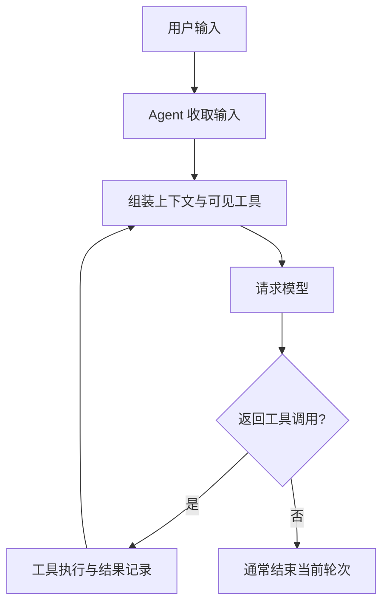

# 第 00 篇：DSH 全景导读——从一次请求到 Agent 的生命周期

[简体中文](00-harness-and-agent-loop.md) | [English](00-harness-and-agent-loop.en.md) · [返回首页](../../README.md)

给模型发一句“帮我分析这个仓库”，模型可以生成文字，也可以提出工具调用。但谁来执行工具？工具结果怎样回到下一次请求？用户点击停止时，谁负责取消？这几件事共同构成了学习 Agent 系统的入口。

这篇导读用 DeepSeek Harness（命令名 `dsh`，下文简称 DSH）回答这些问题。读完后，你应该能画出一次任务的执行链，找到对应源码，并解释为什么“卸载插件”不等于“正在执行的函数立即停止”。

**阅读前提**：知道函数、对象与 Promise 的基本用法即可。文中的命令用于自行复现；本文完成了源码核对和离线实验，没有执行真实模型请求。

**版本基线**：2026-11-18，官方仓库提交 [`38a6a5c`][baseline]，根包版本 `0.2.2-rc.3`。源码示例和配置以这个提交为准。教程使用官方仓库，不包含外围 Desktop 项目的自定义逻辑。DSH 此时仍处于 developer preview。[版本与运行要求][package]

这是一张全景地图。建议先浏览，再跟着[第 01 篇：启动与首次任务](01-first-task.md)动手，随后读[第 02 篇：执行链](02-agent-execution-chain.md)和[第 03 篇：插件与上下文](03-plugins-and-context.md)。

## 1. 模型之外，Harness 做了什么

先把一个任务拆开。假设用户要求：

> 阅读当前仓库的 README 和 package.json，解释项目用途与启动命令，并注明依据。不要修改文件，不要安装依赖。

模型本身接收消息并返回输出；访问仓库文件需要由模型之外的软件执行。在 DSH 中，默认 Agent Loop 驱动模型请求、流式响应与工具执行，工具服务提供执行入口，Session 记录这次任务中发生的事实。[架构说明][architecture]、[循环实现][loop-doc]



这是教学简图，省略了拦截、取消、重试和新输入。真实实现还允许工具执行器结束任务，或在下一步已有输入时继续，因此不能把退出条件简化成唯一的一条 `if`。[`step()` 与 `turn()`][loop]

可以先这样区分：

| 部件 | 在这次任务中承担什么 |
| --- | --- |
| 模型 | 根据输入生成回复或工具调用 |
| Agent Loop | 组织何时请求模型、执行工具以及继续或结束 |
| 工具服务与执行器 | 接收调用，经过相应执行与策略管线，产生结果 |
| Session | 记录历史事实，并为后续模型请求派生消息 |
| Harness | 将模型、循环、工具、会话和策略等运行能力组装起来 |

这里的 Harness 是围绕模型运行任务的软件系统。DSH 选择用插件组织这些能力，连默认循环本身也是插件。[架构与核心包][architecture]

## 2. 先跑通一个有边界的任务

如果你希望边读边操作，可以使用官方源码。该版本声明 Node.js `>=24.9.0`，包管理器为 `pnpm@11.28.5`；先准备这两个版本要求，再执行：[package.json][package]

```bash
git clone https://github.com/deepseek-ai/deepseek-harness.git
cd deepseek-harness
git checkout --detach 38a6a5c965aa99ab525161efb7cc5cf1fe62fced
pnpm install
pnpm run build
pnpm dsh web
```

使用固定提交是为了让本文的文件路径和行为可以对照复现。官方 README 也提供 npm 启动方式；如果使用最新 npm 包，应以对应版本文档为准。[官方运行说明][root]

Web UI 默认地址是 `http://127.0.0.1:3080`，终端输出的实际地址优先。按以下顺序操作：[Web 使用指南][web]

1. 打开 **Settings → Models**，配置模型提供方与凭据。
2. 通过 **Choose workspace** 添加并选择一个用于学习的项目目录。
3. 选择可用模型，新建会话，发送第一节那个限定为阅读文件的任务。
4. 观察模型输出、工具调用与结果，检查最终回答是否引用了文件中的实际内容。

工作区未选择时，输入区不可用；模型路由或凭据未配置好时，也不能把失败归因于 Agent Loop。凭据和模型选项的具体含义见[模型配置指南][providers]。操作是否需要审批，取决于当前权限策略；自然语言中的“不要修改”表达任务意图，权限限制仍需由运行系统落实。

这次实践的验收点很具体：模型确实读取了目标文件；结论能对照文件验证；没有超出任务要求的操作。不同模型的调用次数和措辞可能不同，不要求得到完全一致的轨迹。

## 3. 启动时：配置怎样变成运行中的系统

先读两个入口文件，而不是从所有包里搜索 `agent`：

- [`apps/cli/src/bin.ts`][cli]：`runCli()` 解析命令，把 profile 模式交给 `runProfile()`。
- [`apps/cli/src/profile-boot.ts`][boot]：解析 profile、组合配置层，调用 `boot()` 挂载插件树。

`web` 是一种 profile，即一组应用能力的组合。bundle 则分发插件配置与相应代码。官方架构文档给出的覆盖顺序是：bundle 层 → profile 的补丁 → home 补丁 → `--patch` 覆盖。理解顺序，才能解释“我改了某项配置，最终到底加载了什么”。[Profiles and bundles][architecture]

构建完成后，可以先查看最终配置：

```bash
pnpm dsh --profile web --dump-config
```

这是查看插件组合的入口，不会证明模型可用，更不会替你完成一次任务。查找与 `agent-loop`、`llm`、`tools`、`session` 有关的条目，然后与[架构文档中的核心包表][architecture]对照。

```text
命令选择 profile
  → 合并配置层
  → 挂载插件树
  → 注册服务、事件和清理逻辑
  → 依赖满足的插件进入工作状态
  → 应用可以接收任务
```

“应用已启动”和“Agent 已完成一次模型调用”是两个不同的观察点。

## 4. ctx 是什么：一个能长期存活的上下文对象

Cordis 是 DSH 底层的插件框架。插件通过上下文访问服务，例如 `ctx.llm`、`ctx.tools`、`ctx.sessions`。插件通过 `inject` 声明依赖，注册的事件和副作用应有对应的清理方式。[Cordis 入门][cordis]

这里的上下文不是发送给模型的 token 列表，也不是 JavaScript 的函数调用栈。下面用三种“上下文”划清边界：

| 名称 | 里面是什么 | 生命周期 |
| --- | --- | --- |
| JavaScript 调用栈上下文 | 当前函数调用的执行信息 | 函数调用期间 |
| Cordis `ctx` | 服务访问、事件与插件生命周期关系 | 可以被插件、回调等持续持有 |
| 模型上下文 | 此次请求的消息、工具声明等输入 | 针对一次模型请求构造 |

为了看清对象与闭包的关系，先读一段普通 JavaScript。**这是机制示意，不是 DSH 插件 API：**

```javascript
function attach(ctx, subscribe) {
  return subscribe(async (message) => {
    await ctx.llm.generate(message);
  });
}
```

`attach()` 返回后，订阅者持有的回调仍然引用 `ctx`，所以它可以在之后收到消息时继续使用该对象。原先那次函数调用已经结束，不妨碍对象继续存在。

映射回 DSH：插件通过上下文与服务、事件协作；具体插件上下文带有作用域与生命周期，不能把所有 `ctx` 简化为一个毫无隔离的全局对象。[Cordis 入门][cordis]

## 5. 执行时：沿一次 turn 读源码

先记住两个词：**step** 是一次模型请求及其工具调用；**turn** 可以包含零个或多个 step。输入被拒绝或首次输入被改写为空时，可能已经打开 turn，却没有发生模型调用。[Turn flow][architecture]

实际阅读从 [`packages/core/agent-loop/src/index.ts`][loop-entry] 与 [`src/agent.ts`][loop] 开始：前者提供服务和工厂，后者实现 `ReactLoopAgent`。

| 阅读位置 | 观察什么 |
| --- | --- |
| `AgentLoop` 的工厂与初始化 | 获取或创建 Session，准备作用域，发布 Agent，初始化失败时回滚 |
| `ReactLoopAgent.kick()` | 驱动 turn，并在空闲时处理后续唤醒 |
| `turn()` | 打开 turn，推进 step，处理停止、取消与结束事件 |
| `preStep()` | 收取输入，快照模型选择，解析工具，组装提示，经过 `agent/pre-step` |
| `prepareRequest()` | 经过请求扩展点，并使用 `ctx.llm.prepareCall()` 准备模型调用 |
| `step()` | 记录接受的输入，构造请求，处理模型流，交给 `ctx.tools.execute()` 执行工具 |
| `buildRequest()` | 从 Session 派生消息并构造冻结的请求 |

把上面的职责表放回第一次练习中：用户输入进入待处理队列；驱动器接收输入，准备模型可见内容；模型提出读取文件的工具调用；执行器产生结果；后续请求据此继续生成回答。这个过程可以有多个 step。[循环实现说明][loop-doc]

注意两处容易忽略的细节：

第一，**工具结果需要进入历史，下一次模型请求才能使用它**。DSH 将 Session 日志作为模型历史的来源，通过 `deriveMessages()` 派生消息；日志中也有生命周期等不直接进入模型输入的事件，不能把整个日志原样等同于 prompt。[Session log][architecture]

第二，**流式显示和持久历史是不同的观察面**。实时输出通过 `agent/assistant-stream` 暴露；成功的完整助手消息或失败尝试有相应的 Session 记录。看到 UI 打字，不代表每个瞬时片段都是独立的持久消息。[流与日志][architecture]

## 6. 运行中卸载插件，会发生什么

先拆成两个问题：**后续还能不能找到能力？已经开始的工作怎样结束？**

从注册表移除服务，会影响后续查找与依赖关系。已经拿到对象引用的异步函数，不会因为一个注册项被删除就自动消失。Cordis 负责组织可逆注册与插件生命周期；具体工作是否能取消，还需要实现相应的清理逻辑。[Cordis 入门][cordis]、[Agent teardown][loop-doc]

对 DSH 默认循环，可以在工厂的 `FactoryOwnership.dispose()` 和 Agent 的 teardown 路径中看到：清理需要停止接收新工作，触发取消，并等待在途工作收敛后再释放资源。不要把这条具体实现推导为“任何插件卸载都能自动取消任意请求”。[工厂源码][loop-entry]

下面这些情况不能混为一谈：

| 发生的变化 | 应如何理解 |
| --- | --- |
| 卸载一个不相关的插件 | 不能据此认定当前模型请求会停止 |
| 移除服务或工具注册 | 影响后续使用；在途工作需看已有引用、作用域与取消实现 |
| 默认 Agent Loop 的所有者或工厂卸载 | 进入其定义的取消、等待与资源释放流程 |
| 同一对象内部改一个配置字段 | 不等同于撤销并重新注册服务 |
| 一次请求超时或报错 | 不等同于插件或服务被卸载 |

“模型等待插件卸载”也容易让人误解。通常是 Harness 的清理流程等待任务退出，或者向任务发出取消信号；模型服务本身未必知道本地发生了插件卸载。

## 7. 离线实验：删除注册，并不终止请求

仓库提供了一个[可运行的教学实验](../../labs/dsh-lifecycle-demo.mjs)。它只使用 Node.js 内置模块，没有网络、密钥和文件写入，也没有依赖 DSH。

在 Agent101 仓库根目录运行：

```bash
node labs/dsh-lifecycle-demo.mjs
```

预期输出：

```text
Scenario: remove only
1. request started; waiting for mock response
2. registry entry removed; has llm = false
3. no cancellation; mock response is delivered
4. request completed; cleanup can finish

Scenario: remove + cancel
1. request started; waiting for mock response
2. registry entry removed; has llm = false
3. cleanup explicitly aborts and awaits the request
4. request cancelled; cleanup can finish
```

第一组保留了调用者已经拿到的服务引用；从 `Map` 删除注册，不影响这个引用等待结果。第二组显式调用 `AbortController.abort()`，而模拟请求实现了对信号的响应，因此以取消结束。**只有发出信号、没有实现响应，也不能保证任意任务会停止。**

实验里的“响应”是手动完成的 Promise。它验证的是 JavaScript 引用、异步等待与协作取消，不验证 Cordis 的依赖图、DSH 的网络传输或服务热替换行为。

为什么两件事能在同一个进程里发生？请求函数遇到未完成的 `await` 会暂停这个异步函数的后续执行，其他代码可以继续运行。这里没有第二个进程修改注册表，也没有同时执行两段 JavaScript 同步代码。真正的 DSH 工具可能启动子进程；不要把“这个实验不需要额外进程”推广成“整个 DSH 只有一个进程”。

## 8. 用三个问题检查自己是否理解

1. **一次 turn 一定调用一次模型吗？** 不一定，可能零次或多次。turn 是任务推进的边界，step 才对应模型请求及工具调用。
2. **删除 `llm` 注册，正在等待的请求一定停止吗？** 不一定。必须检查任务持有的引用、取消信号和清理实现。
3. **下一次请求为什么知道工具读到了什么？** 工具结果进入 Session 历史，模型消息由日志派生；完整日志还包含模型看不到的事件。

动手阅读时，可以再做一个小练习：在固定版本中找到 `preStep()`、`step()`、`tools.execute()` 和 `deriveMessages()`，把它们标在自己的执行链图上。完成后，你读懂的就是实际调用关系，而不只是记住了几个包名。

## 一手资料与验证范围

本文的源码说明基于干净的官方 checkout，固定提交如开头所示；仓库中的离线实验已实际运行并通过内置断言。源码构建、Web 操作和真实模型任务是供读者复现的步骤，本次没有执行，也没有生成性能或成功率数据。

- [官方 README 与运行说明][root]
- [版本、Node.js 与包管理器要求][package]
- [架构：启动组合、核心包、Turn flow 与 Session log][architecture]
- [Cordis 入门：上下文、依赖、事件与可逆注册][cordis]
- [Web 使用指南][web]与[模型配置][providers]
- [CLI 入口][cli]与[Profile 启动][boot]
- [Agent Loop 包说明][loop-doc]、[插件工厂][loop-entry]与[执行驱动器][loop]

[baseline]: https://github.com/deepseek-ai/deepseek-harness/tree/38a6a5c965aa99ab525161efb7cc5cf1fe62fced
[root]: https://github.com/deepseek-ai/deepseek-harness/blob/38a6a5c965aa99ab525161efb7cc5cf1fe62fced/README.md
[package]: https://github.com/deepseek-ai/deepseek-harness/blob/38a6a5c965aa99ab525161efb7cc5cf1fe62fced/package.json
[architecture]: https://github.com/deepseek-ai/deepseek-harness/blob/38a6a5c965aa99ab525161efb7cc5cf1fe62fced/docs/architecture.md
[cordis]: https://github.com/deepseek-ai/deepseek-harness/blob/38a6a5c965aa99ab525161efb7cc5cf1fe62fced/docs/cordis-primer.md
[web]: https://github.com/deepseek-ai/deepseek-harness/blob/38a6a5c965aa99ab525161efb7cc5cf1fe62fced/docs/user/guide/index.md
[providers]: https://github.com/deepseek-ai/deepseek-harness/blob/38a6a5c965aa99ab525161efb7cc5cf1fe62fced/docs/user/guide/providers.md
[cli]: https://github.com/deepseek-ai/deepseek-harness/blob/38a6a5c965aa99ab525161efb7cc5cf1fe62fced/apps/cli/src/bin.ts
[boot]: https://github.com/deepseek-ai/deepseek-harness/blob/38a6a5c965aa99ab525161efb7cc5cf1fe62fced/apps/cli/src/profile-boot.ts
[loop-doc]: https://github.com/deepseek-ai/deepseek-harness/blob/38a6a5c965aa99ab525161efb7cc5cf1fe62fced/packages/core/agent-loop/README.md
[loop-entry]: https://github.com/deepseek-ai/deepseek-harness/blob/38a6a5c965aa99ab525161efb7cc5cf1fe62fced/packages/core/agent-loop/src/index.ts
[loop]: https://github.com/deepseek-ai/deepseek-harness/blob/38a6a5c965aa99ab525161efb7cc5cf1fe62fced/packages/core/agent-loop/src/agent.ts
