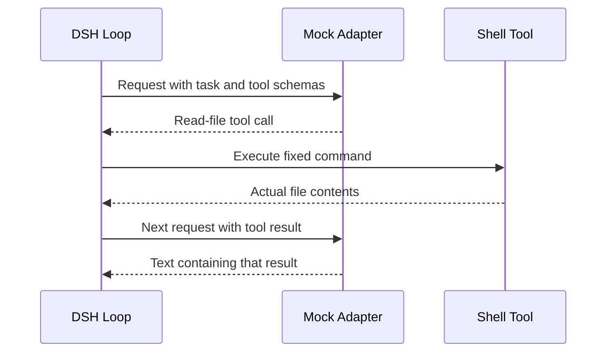

# Chapter 01: Start DSH and Observe Your First Task

[简体中文](01-first-task.md) | [English](01-first-task.en.md) · [Overview](00-harness-and-agent-loop.en.md) · [Next: execution chain](02-agent-execution-chain.en.md) · [Home](../../README_EN.md)

Start with one complete, small task: request two files, receive their contents, and reply. This chapter runs a task without an API key, turns its progress into observable events, and then explains how to repeat it with a real model.

**Goal**: run DSH's headless profile and identify a tool call, its result, and the final response. Understanding every plugin or source file can wait.

## 1. What are we running?

The experiment uses the real CLI, agent loop, Shell tool, and Session from DSH `0.2.2-rc.3`. Only the model adapter is replaced. It always requests `README.md` and `package.json` from the fixture workspace, then returns the actual tool result as text.

The mock **does not understand arbitrary tasks or analyze the project's purpose**. It separates model intelligence from the functioning tool loop. The implementation adapts the official [keyless CLI adapter][fixture] and [headless patch][patch].

The patch also disables auxiliary session-title generation, keeping those requests separate from the two main-task calls. Not every model request in a default DSH application necessarily belongs to its main loop. [Title-generation implementation][title]

| Part | Implementation in this experiment |
| --- | --- |
| Model output | Fixed local responses; no model API calls |
| Agent loop and tool execution | Real installed DSH implementation |
| Files read by the tool | Real repository fixtures, copied to a fresh temporary workspace |
| Configuration and Session | Fresh temporary homes, separate from your normal DSH home |

Source reading is pinned to official commit [`38a6a5c`][baseline]. Runtime packages and transitive dependencies are pinned by the [lab lockfile](../../labs/dsh/package-lock.json). A package version and source revision are recorded separately; matching version numbers alone do not prove that every published file equals a checkout.

## 2. Install and run

Prepare Node.js `>=24.9.0` and npm. Check `node --version` first: an older Node may install packages successfully but fail at startup. [Official requirements][package]

From the Agent101 root:

```bash
cd labs/dsh
npm ci
npm run first-task
```

The initial installation includes the complete DSH runtime and its dependencies, requiring network access and disk space. The experiment makes no real model requests and needs no credentials. Do not add API keys to the experiment files.

Read [`run-headless.mjs`](../../labs/dsh/run-headless.mjs) to see the setup: copy the fixture, prepare isolated directories, launch the official DSH CLI with `headless`, apply the mock adapter patch, and request `--json` output.

The script selects the `workspace-write` permission preset and `never` approval policy, which rejects operations requiring human approval. The mock emits only this fixed Shell command:

```bash
cat README.md package.json
```

The Windows branch uses `Get-Content`; see the verification record for the platform actually tested. Tool execution remains subject to platform and sandbox support. A natural-language request not to modify files does not replace permission enforcement. [Headless permissions and output][headless]

## 3. Find three pieces of evidence

Stdout contains newline-delimited JSON. Diagnostics and the artifact directory are printed to stderr. Start by finding three events:

| Event | Fields to inspect | What it establishes |
| --- | --- | --- |
| `tool_call` | Tool name and read command | The Agent received a proposed action |
| `tool_result` | Returned content and error fields | Tool execution produced a result |
| `final` | `reason.kind` and `text` | How the turn ended and what the final response says |

The opening event is `session`; intermediate events may include `status` and `text`. `final.text` should contain `agent101-dsh-fixture` and the fixture README content. Do not rely on the final response alone: a fixed model could claim to have read files. **The tool result is the key evidence of the actual read in this experiment.**

A successful run also prints:

```text
PASS: real DSH tool round trip completed; fixture files unchanged
```

The script checks process exit status, opening and closing events, tool events, the final `completed` reason, and unchanged contents of all three fixture files. Full NDJSON and diagnostics remain in the printed temporary directory:

```text
<temporary run directory>/events.jsonl
<temporary run directory>/stderr.log
```

This output is a headless projection of the Session, **not the raw Session log**. A returned `tool_result` does not necessarily mean the Shell command inside it succeeded, and a completed turn does not automatically mean a business task is correct. Checking the fixture content supplies that additional evidence. [JSON output contract][headless]

## 4. Compare the answer with the files

Open the [fixture workspace](../../labs/dsh/workspace/README.md) and check independently:

1. The package name is `agent101-dsh-fixture`; its `start` script is `node server.mjs`.
2. The README says `npm start` prints `fixture ready` and exits, rather than starting a server.

The mock returns the read result. It has not inferred the startup instructions. What you are checking is whether real tool output reaches the next request:



## 5. Repeat with a real model

After the offline experiment, launch the official Web interface from `labs/dsh`:

```bash
npx --no-install dsh web
```

This starts the normal Web profile and uses your normal DSH home. **Do not apply the mock adapter patch.** The default address is `http://127.0.0.1:3080`; use the actual URL printed by the terminal. [Official instructions][root]

Follow the [official Web guide][web]: configure **Settings → Models**, use **Choose workspace** to select `labs/dsh/workspace`, create a session, and submit:

> Read README.md and package.json. Explain the project's purpose and startup instructions, citing evidence. Do not modify files, install dependencies, or start the project.

This requires your own working model and credentials and may incur model charges. These are reproduction instructions, separate from the completed offline validation.

Observe which tools the real model chooses, what it reads, and whether its conclusions match the files. It may read both files with one Shell call or use separate reads. Its trace need not match the mock's.

## 6. Troubleshoot by observation point

| Symptom | First check |
| --- | --- |
| Syntax or Node error at startup | `node --version`, meeting `>=24.9.0` |
| DSH package not found | Whether `npm ci` completed in `labs/dsh` |
| Installation reports `ENOSPC` | Insufficient disk space; allow several GB for the full runtime and retry after cleaning the failed installation |
| Startup error without tool events | Temporary `stderr.log`; resolve profile or plugin loading first |
| Tool denied or sandbox unavailable | `tool_result.error` and platform diagnostics; do not hide the problem by switching to unrestricted access |
| A `final` event exists but the task failed | Process status, `final.reason`, tool results, and file evidence together |
| Web composer unavailable | Selected workspace and configured model |

## 7. Check understanding and validation scope

- What is mocked? Only the local adapter's model output. DSH tool execution is real.
- Why inspect `tool_result`? It distinguishes a proposed read from returned read evidence.
- Why check the files manually? A healthy runtime and a correct task require different evidence.

Actual platform, commands, and results are saved in the [verification record](../../labs/dsh/evidence/verification.json). It covers only the listed versions and experiments, not real-provider reasoning, network protocols, or Windows behavior.

The next chapter follows this run from `followup()` through model requests and tool execution.

[baseline]: https://github.com/deepseek-ai/deepseek-harness/tree/38a6a5c965aa99ab525161efb7cc5cf1fe62fced
[package]: https://github.com/deepseek-ai/deepseek-harness/blob/38a6a5c965aa99ab525161efb7cc5cf1fe62fced/package.json
[root]: https://github.com/deepseek-ai/deepseek-harness/blob/38a6a5c965aa99ab525161efb7cc5cf1fe62fced/README.md
[web]: https://github.com/deepseek-ai/deepseek-harness/blob/38a6a5c965aa99ab525161efb7cc5cf1fe62fced/docs/user/guide/index.md
[fixture]: https://github.com/deepseek-ai/deepseek-harness/blob/38a6a5c965aa99ab525161efb7cc5cf1fe62fced/packages/test-support/loader-smoke/tests/fixtures/cli-mock-llm.ts
[patch]: https://github.com/deepseek-ai/deepseek-harness/blob/38a6a5c965aa99ab525161efb7cc5cf1fe62fced/apps/cli/tests/profiles/headless/tests/fixtures/headless-profile.patch.yml
[headless]: https://github.com/deepseek-ai/deepseek-harness/blob/38a6a5c965aa99ab525161efb7cc5cf1fe62fced/packages/bundle/headless/README.md
[title]: https://github.com/deepseek-ai/deepseek-harness/blob/38a6a5c965aa99ab525161efb7cc5cf1fe62fced/packages/session/session-title-llm/src/index.ts
