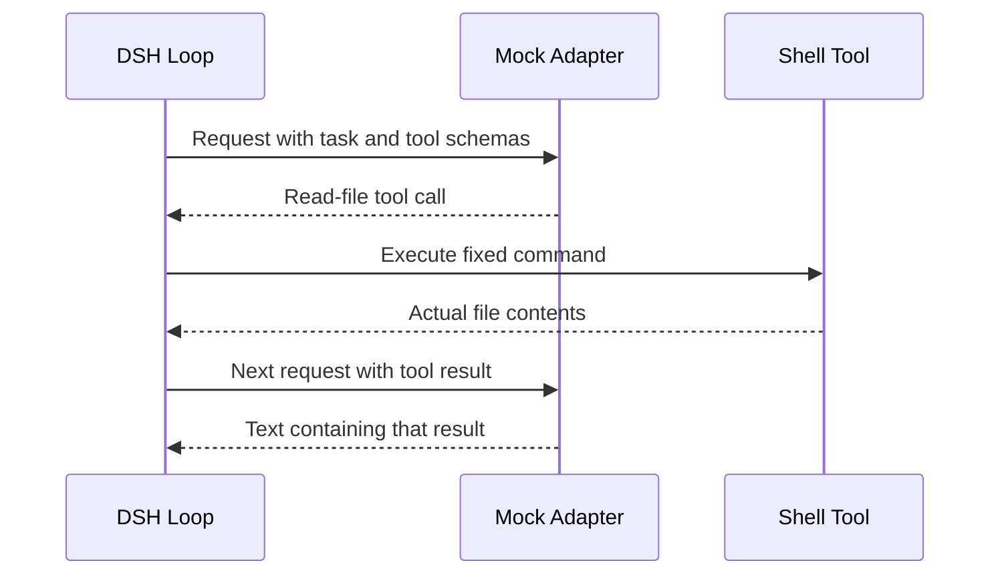

# 第 01 篇：启动 DSH，观察你的第一个任务

[简体中文](01-first-task.md) | [English](01-first-task.en.md) · [导读](00-harness-and-agent-loop.md) · [下一篇：执行链](02-agent-execution-chain.md) · [首页](../../README.md)

第一次学习 Agent，先观察一件完整的小事：它怎样请求读取两个文件，拿到结果，再给出回复？本篇先跑一个无需 API Key 的任务，把这些步骤变成能检查的事件，再说明怎样换成真实模型。

**本篇目标**：跑通 DSH 的 headless profile，找到工具调用、工具结果和最终回复三个观察点。先不用理解全部插件和源码。

## 1. 先说清楚我们运行的是什么

配套实验使用 DSH `0.2.2-rc.3` 的真实 CLI、Agent Loop、Shell 工具和 Session。我们只替换模型适配器，让它固定请求读取练习目录中的 `README.md` 与 `package.json`，收到真实工具结果后原样返回。

模拟模型**不理解任意任务，也不分析项目用途**。这样可以把“模型是否聪明”与“工具闭环能否运行”分开验证。实现改编自官方的[无密钥 CLI 测试适配器][fixture]和[headless 测试补丁][patch]。

补丁还禁用辅助会话标题生成，避免标题请求混入主任务的两次模型调用；默认 DSH 的所有请求不一定都来自主循环。[标题生成实现][title]

| 部分 | 本实验使用什么 |
| --- | --- |
| 模型输出 | 本地固定输出，无模型 API 请求 |
| Agent 循环与工具执行 | 安装的 DSH 真实实现 |
| 工具读取的文件 | 仓库提供的真实练习文件，每次复制到临时工作区 |
| 配置与 Session | 每次运行新建临时 home，不使用你平时的 DSH home |

源码阅读基线为官方提交 [`38a6a5c`][baseline]，运行包版本与间接依赖固定在[实验锁文件](../../labs/dsh/package-lock.json)。包版本和源码提交分别记录，不能仅凭版本号断言整个发布物与 checkout 逐字一致。

## 2. 安装并运行

准备 Node.js `>=24.9.0` 和 npm。先检查 `node --version`，旧版 Node 可能安装成功却在启动时报错。[官方运行要求][package]

在 Agent101 根目录执行：

```bash
cd labs/dsh
npm ci
npm run first-task
```

首次安装包含完整 DSH 运行时和依赖，需要网络与磁盘空间。运行脚本本身不请求真实模型，也不需要凭据。不要把 API Key 填进实验文件。

脚本实际做的事情可以直接在 [`run-headless.mjs`](../../labs/dsh/run-headless.mjs) 中看到：复制练习文件，准备隔离目录，通过 DSH 官方 CLI 启动 `headless`，加上模拟模型补丁，并开启 `--json` 输出。

它选择 `workspace-write` 权限预设和 `never` 审批策略；需要人工批准的操作会被拒绝。模型固定发出的 Shell 命令只有：

```bash
cat README.md package.json
```

Windows 分支使用 `Get-Content`；本仓库的实际验证平台见下方运行记录。Shell 工具执行受当前平台和沙箱实现约束，不能只用自然语言中的“不要修改”代替权限控制。[headless 的权限与输出说明][headless]

## 3. 从输出中找三个证据

标准输出是逐行 JSON，诊断信息和运行目录写到标准错误。先不要追求每一行字段都懂，找这三个事件：

| 事件 | 要检查的内容 | 它能说明什么 |
| --- | --- | --- |
| `tool_call` | 工具名与文件读取命令 | Agent 收到了模型提出的行动 |
| `tool_result` | 返回内容与错误字段 | 工具实际执行后产生了结果 |
| `final` | `reason.kind` 和 `text` | 轮次以什么状态结束，最终回复是什么 |

`session` 是开场事件；中间还可能有 `status`、`text` 等事件。`final.text` 应包含 `agent101-dsh-fixture` 以及练习 README 的内容。不要只看最终回复：固定模型可以声称读了文件，**工具结果才是本实验观察实际读取的关键证据**。

成功时，还应看到：

```text
PASS: real DSH tool round trip completed; fixture files unchanged
```

脚本同时检查进程退出码、首尾事件、工具事件存在、最终 `completed` 状态，以及三个练习文件的内容没有变化。完整 NDJSON 和诊断文件保留在打印出的临时目录：

```text
<temporary run directory>/events.jsonl
<temporary run directory>/stderr.log
```

这份输出是 headless 对 Session 的投影，**不是原始 Session 日志**。`tool_result` 返回并不自动意味着其中运行的 Shell 命令成功；最终轮次完成也不自动意味着业务任务正确。本实验再检查文件内容，正是为了补上这一层。[JSON 输出契约][headless]

## 4. 用练习文件核对回复

打开[练习目录](../../labs/dsh/workspace/README.md)，独立检查两件事：

1. 项目名是 `agent101-dsh-fixture`，`start` 脚本是 `node server.mjs`。
2. README 说明 `npm start` 打印 `fixture ready` 后退出，不会启动服务器。

模拟模型返回的是读取结果，并没有“推理出启动方式”。你核对的是工具返回内容能否进入下一次请求。到这里，一个真实 Harness + 固定模型的闭环已经足够清楚：



## 5. 换成真实模型，再做同一个任务

离线实验之后，可以使用官方 Web 入口。仍在 `labs/dsh` 中运行：

```bash
npx --no-install dsh web
```

这一步会启动正常 Web profile，使用正常 DSH home；**不要加实验的模拟模型补丁**。默认地址为 `http://127.0.0.1:3080`，以终端实际输出为准。[官方运行说明][root]

按[官方 Web 指南][web]操作：配置 **Settings → Models**，通过 **Choose workspace** 选中 `labs/dsh/workspace`，新建会话并提交：

> 阅读 README.md 和 package.json，说明项目用途和启动方式。请注明依据，不要修改文件，不要安装或启动项目。

这一步需要你自己的可用模型与凭据，可能产生模型费用。这里提供复现步骤，不把它算进已完成的离线验证。

观察真实模型是否选择工具、实际读取了哪些文件，以及最终结论能否对照文件成立。它可能只调用一次 Shell，也可能分别读取文件；不要求与模拟模型的轨迹相同。

## 6. 卡住时，按观察点排查

| 现象 | 先看哪里 |
| --- | --- |
| 启动即报语法或 Node 版本错误 | `node --version`，是否满足 `>=24.9.0` |
| 找不到 DSH 包 | 是否在 `labs/dsh` 完成 `npm ci` |
| 安装报 `ENOSPC` | 磁盘空间不足；完整运行时需预留数 GB 安装空间，清理本次失败安装后重试 |
| 没有工具事件，只有启动错误 | 临时目录中的 `stderr.log`，先解决 profile 或插件加载错误 |
| 工具被策略拒绝、沙箱不可用 | `tool_result.error` 与平台沙箱诊断；不要直接换成无限制权限掩盖问题 |
| 有 `final`，但任务未成功 | 同时看进程退出码、`final.reason`、工具结果和文件证据 |
| Web 输入框不可用 | 是否选择工作区、模型是否配置可用 |

## 7. 检查理解与验证范围

- 哪部分是模拟的？只有本地适配器的模型输出，DSH 的工具执行不是模拟。
- 为什么要看 `tool_result`？它把“提出读取”与“实际返回读取结果”区分开。
- 为什么还要手工核对文件？运行正常与任务正确需要不同的证据。

实际运行证据与平台、命令、结果保存在[验证记录](../../labs/dsh/evidence/verification.json)。该记录只覆盖列出的版本和实验；没有验证真实提供方的推理能力、网络协议或 Windows 行为。

下一篇沿着这次实验，从 `followup()` 找到模型请求和工具执行的真实调用链。

[baseline]: https://github.com/deepseek-ai/deepseek-harness/tree/38a6a5c965aa99ab525161efb7cc5cf1fe62fced
[package]: https://github.com/deepseek-ai/deepseek-harness/blob/38a6a5c965aa99ab525161efb7cc5cf1fe62fced/package.json
[root]: https://github.com/deepseek-ai/deepseek-harness/blob/38a6a5c965aa99ab525161efb7cc5cf1fe62fced/README.md
[web]: https://github.com/deepseek-ai/deepseek-harness/blob/38a6a5c965aa99ab525161efb7cc5cf1fe62fced/docs/user/guide/index.md
[fixture]: https://github.com/deepseek-ai/deepseek-harness/blob/38a6a5c965aa99ab525161efb7cc5cf1fe62fced/packages/test-support/loader-smoke/tests/fixtures/cli-mock-llm.ts
[patch]: https://github.com/deepseek-ai/deepseek-harness/blob/38a6a5c965aa99ab525161efb7cc5cf1fe62fced/apps/cli/tests/profiles/headless/tests/fixtures/headless-profile.patch.yml
[headless]: https://github.com/deepseek-ai/deepseek-harness/blob/38a6a5c965aa99ab525161efb7cc5cf1fe62fced/packages/bundle/headless/README.md
[title]: https://github.com/deepseek-ai/deepseek-harness/blob/38a6a5c965aa99ab525161efb7cc5cf1fe62fced/packages/session/session-title-llm/src/index.ts
