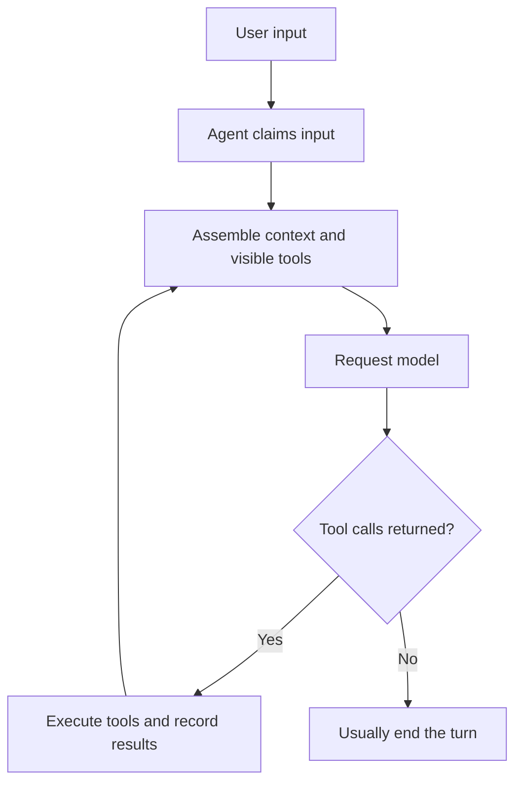

# Episode 01: Understanding DSH—from a Request to the Agent Lifecycle

[简体中文](01-harness-and-agent-loop.md) | [English](01-harness-and-agent-loop.en.md) · [Back to overview](../../README_EN.md)

Ask a model to analyze a repository, and it can generate text or propose tool calls. But who executes those tools? How do their results reach the next request? When the user clicks Stop, who cancels the work? These questions are a useful starting point for understanding agent systems.

This tutorial uses DeepSeek Harness, whose command is `dsh` and which we call DSH below, to answer them. By the end, you should be able to trace a task, locate its implementation, and explain why unloading a plugin does not immediately stop a running function.

**Prerequisites**: basic familiarity with functions, objects, and Promises. Commands are provided for reproduction. Source inspection and the offline experiment were completed for this tutorial; no real model requests were executed.

**Version baseline**: 2026-11-18, official repository commit [`38a6a5c`][baseline], root package version `0.2.2-rc.3`. Paths and behavior refer to this commit. The tutorial uses the official repository and excludes custom behavior in the surrounding Desktop project. DSH was in developer preview at this baseline. [Version and runtime requirements][package]

## 1. What the harness does around the model

Consider this task:

> Read README and package.json in the current repository. Explain the project's purpose and startup commands, citing the files. Do not modify files or install dependencies.

The model receives messages and produces output; software outside the model must access repository files. In DSH, the default agent loop drives model requests, streaming responses, and tool execution. The tool service provides execution entry points, while the Session records facts about the task. [Architecture][architecture], [loop implementation guide][loop-doc]



This teaching diagram omits interception, cancellation, retries, and new input. The actual implementation also allows a tool executor to conclude work, or pending next-step input to keep it going. There is more than one stopping condition. [`step()` and `turn()`][loop]

| Component | Responsibility in this task |
| --- | --- |
| Model | Generate a reply or tool calls from the supplied input |
| Agent loop | Decide when to request the model, run tools, continue, or stop |
| Tool service and executor | Receive calls, apply execution and policy pipelines, and produce results |
| Session | Record historical facts and derive messages for later requests |
| Harness | Assemble the model, loop, tools, sessions, policies, and other runtime capabilities |

A harness is the software system around a model that runs tasks. DSH organizes these capabilities as plugins, including the default loop itself. [Architecture and core packages][architecture]

## 2. Run a task with explicit boundaries

To follow along, use the official source. This version declares Node.js `>=24.9.0` and `pnpm@11.28.5`. Prepare those prerequisites before running: [package.json][package]

```bash
git clone https://github.com/deepseek-ai/deepseek-harness.git
cd deepseek-harness
git checkout --detach 38a6a5c965aa99ab525161efb7cc5cf1fe62fced
pnpm install
pnpm run build
pnpm dsh web
```

Pinning the commit lets you follow the same paths and behavior described here. The official README also provides an npm launch option; consult the matching documentation if using a newer npm release. [Official run instructions][root]

The default Web UI address is `http://127.0.0.1:3080`; use the actual address printed by the terminal. Then follow these steps: [Web guide][web]

1. Open **Settings → Models** and configure a provider and credentials.
2. Use **Choose workspace** to add and select a project directory for learning.
3. Select an available model, create a session, and submit the reading-only task from section 1.
4. Observe the output, tool calls, and results. Check the final answer against the actual files.

The composer remains unavailable until a workspace is selected. A missing route or invalid credentials is also a different failure from a loop bug. See the [model configuration guide][providers] for provider settings. Approval requirements depend on the active permission policy: a prompt saying “do not modify files” expresses task intent, while the runtime must enforce access restrictions.

The acceptance criteria are concrete: the agent reads the target files, its conclusions match those files, and its actions stay within the task. Models may take different numbers of steps or use different wording; identical traces are not required.

## 3. Startup: from configuration to a running system

Start with two entry files rather than searching every package for `agent`:

- [`apps/cli/src/bin.ts`][cli]: `runCli()` parses the command and delegates profile execution to `runProfile()`.
- [`apps/cli/src/profile-boot.ts`][boot]: resolves the profile, composes configuration layers, and calls `boot()` to mount the plugin tree.

`web` is a profile: a composition of application capabilities. A bundle distributes plugin configuration and the code it mounts. The documented layer order is bundle layers → profile patch → home patch → `--patch` overlays. This order explains which configuration ultimately takes effect. [Profiles and bundles][architecture]

After building, inspect the resolved configuration:

```bash
pnpm dsh --profile web --dump-config
```

This shows the plugin composition. It does not prove model connectivity or complete a task. Find entries related to `agent-loop`, `llm`, `tools`, and `session`, and compare them with the [core package table][architecture].

```text
Command selects a profile
  → Configuration layers are composed
  → Plugin tree is mounted
  → Services, events, and cleanup effects are registered
  → Plugins with satisfied dependencies become active
  → Application can receive tasks
```

Application startup and a completed model call are separate milestones.

## 4. What ctx means: an object that can outlive a function call

Cordis is DSH's underlying plugin framework. Plugins access services through a context, such as `ctx.llm`, `ctx.tools`, and `ctx.sessions`. They declare dependencies through `inject`, and event registrations and effects should have corresponding cleanup. [Cordis primer][cordis]

This context is distinct from both the model's token input and JavaScript's function execution context:

| Context | Contents | Lifetime |
| --- | --- | --- |
| JavaScript call-stack context | Execution information for the current function invocation | During the invocation |
| Cordis `ctx` | Service access, events, and plugin lifecycle relationships | Can remain referenced by plugins and callbacks |
| Model context | Messages, tool declarations, and other request inputs | Constructed for a model request |

Consider this ordinary JavaScript example to understand references and closures. **It illustrates the mechanism; it is not the DSH plugin API.**

```javascript
function attach(ctx, subscribe) {
  return subscribe(async (message) => {
    await ctx.llm.generate(message);
  });
}
```

After `attach()` returns, the subscriber's callback still references `ctx`. The callback can use it when a message arrives later. The original function invocation has ended, but the object can remain alive.

In DSH, plugins cooperate through contexts, services, and events. Actual plugin contexts have scope and lifecycle relationships; treating every `ctx` as one unrestricted global object would lose those distinctions. [Cordis primer][cordis]

## 5. Execution: follow one turn through the source

Two terms matter: a **step** is one model request plus the tools it calls; a **turn** contains zero or more steps. If input is rejected or the first accepted input is rewritten to empty, a turn may open without making a model call. [Turn flow][architecture]

Read [`packages/core/agent-loop/src/index.ts`][loop-entry] and [`src/agent.ts`][loop]. The former provides the service and factory; the latter implements `ReactLoopAgent`.

| Reading location | What to look for |
| --- | --- |
| `AgentLoop` factory and initialization | Acquire or create a Session, prepare scope, publish the Agent, and roll back failed initialization |
| `ReactLoopAgent.kick()` | Drive turns and handle subsequent wakeups after becoming idle |
| `turn()` | Open a turn, advance steps, and handle stopping, cancellation, and closing events |
| `preStep()` | Claim input, snapshot model selection, resolve tools, assemble the prompt, and run `agent/pre-step` |
| `prepareRequest()` | Run the request extension point and prepare the call through `ctx.llm.prepareCall()` |
| `step()` | Record admitted input, construct the request, process the model stream, and invoke `ctx.tools.execute()` |
| `buildRequest()` | Derive messages from the Session and construct a frozen request |

Now map these responsibilities to the exercise: user input enters the inbox; the driver claims it and prepares model-visible content; the model proposes file-reading calls; the executor produces results; a later request uses those results to continue the answer. This can span several steps. [Loop guide][loop-doc]

Two details deserve attention.

First, **tool results must become part of history for the next model request to use them**. DSH treats the Session log as the source of model history and derives messages through `deriveMessages()`. The log also contains lifecycle events that are not model input, so the full log is not identical to the prompt. [Session log][architecture]

Second, **live display and durable history are separate views**. Live output is exposed through `agent/assistant-stream`; completed assistant messages and failed attempts have corresponding Session records. Visible streaming does not mean each transient fragment is an independent durable message. [Streaming and logging][architecture]

## 6. What happens when a plugin is unloaded during execution

Separate two questions: **Can later code still discover the capability? How does already-started work finish?**

Removing a service registration affects later lookup and dependency relationships. An asynchronous function that already holds an object reference does not disappear because a registry entry was deleted. Cordis organizes reversible registrations and plugin lifecycles; cancelling actual work requires appropriate cleanup behavior. [Cordis primer][cordis], [Agent teardown][loop-doc]

For DSH's default loop, `FactoryOwnership.dispose()` and the Agent teardown path show explicit responsibilities: stop accepting new work, request cancellation, await in-flight work, and then release resources. This concrete implementation does not imply that unloading any plugin automatically cancels arbitrary requests. [Factory source][loop-entry]

| Change | Interpretation |
| --- | --- |
| Unload an unrelated plugin | This alone does not establish that the current model request stops |
| Remove a service or tool registration | Later use is affected; in-flight behavior depends on existing references, scope, and cancellation |
| Unload the default loop's owner or factory | Follow its defined cancellation, draining, and resource-release sequence |
| Change a field inside the same object | This is different from withdrawing and registering a service again |
| A request times out or fails | This does not mean a plugin or service was unloaded |

Saying “the model waits for plugin unloading” is misleading. Usually the harness cleanup waits for work to settle or sends a cancellation signal. The remote model service may have no knowledge of local plugin unloading.

## 7. Offline experiment: removing a registration does not stop a request

This repository includes a [runnable teaching experiment](../../labs/dsh-lifecycle-demo.mjs). It uses only Node.js built-ins, with no network, credentials, file writes, or DSH dependency.

Run it from the Agent101 repository root:

```bash
node labs/dsh-lifecycle-demo.mjs
```

Expected output:

```text
Scenario: remove only
1. request started; waiting for mock response
2. registry entry removed; has llm = false
3. no cancellation; mock response is delivered
4. request completed; cleanup can finish

Scenario: remove + cancel
1. request started; waiting for mock response
2. registry entry removed; has llm = false
3. cleanup explicitly aborts and awaits the request
4. request cancelled; cleanup can finish
```

The first scenario retains the service reference already acquired by the caller. Removing its `Map` entry does not prevent that reference from waiting for a result. The second explicitly calls `AbortController.abort()`, and the simulated request responds to that signal, so it finishes as cancelled. **Sending a signal without implementing a response cannot guarantee that arbitrary work stops.**

The “response” here is a manually resolved Promise. The experiment demonstrates JavaScript references, asynchronous waiting, and cooperative cancellation. It does not validate Cordis dependency graphs, DSH network transport, or service hot replacement.

How can both operations happen in one process? An unresolved `await` suspends the remainder of that asynchronous function, allowing other code to run. No second process modifies the registry here, and two synchronous JavaScript sections do not run simultaneously. Actual DSH tools may spawn subprocesses; this experiment does not imply that the whole DSH application uses only one process.

## 8. Check your understanding

1. **Does a turn always call the model once?** No: it may call zero or multiple times. A turn is a boundary for progressing work; a step corresponds to a model request and its tool calls.
2. **Does deleting the `llm` registration always stop a waiting request?** No. Inspect retained references, cancellation signals, and cleanup behavior.
3. **How does the next request know what a tool read?** Tool results enter Session history, from which model messages are derived. The full log also includes events the model does not see.

As a source-reading exercise, locate `preStep()`, `step()`, `tools.execute()`, and `deriveMessages()` at the pinned commit. Place them on your own execution diagram. That connects the concepts to actual calls rather than package names alone.

## Primary sources and validation scope

Source explanations use a clean official checkout at the pinned commit. The offline experiment was executed and passed its embedded assertions. Source builds, Web UI interaction, and real model tasks are reader reproduction steps; they were not executed for this tutorial. No performance or success-rate data was produced.

- [Official README and run instructions][root]
- [Version, Node.js, and package-manager requirements][package]
- [Architecture: startup composition, core packages, turn flow, and Session log][architecture]
- [Cordis primer: contexts, dependencies, events, and reversible registrations][cordis]
- [Web guide][web] and [model configuration][providers]
- [CLI entry][cli] and [profile boot][boot]
- [Agent Loop guide][loop-doc], [plugin factory][loop-entry], and [execution driver][loop]

[baseline]: https://github.com/deepseek-ai/deepseek-harness/tree/38a6a5c965aa99ab525161efb7cc5cf1fe62fced
[root]: https://github.com/deepseek-ai/deepseek-harness/blob/38a6a5c965aa99ab525161efb7cc5cf1fe62fced/README.md
[package]: https://github.com/deepseek-ai/deepseek-harness/blob/38a6a5c965aa99ab525161efb7cc5cf1fe62fced/package.json
[architecture]: https://github.com/deepseek-ai/deepseek-harness/blob/38a6a5c965aa99ab525161efb7cc5cf1fe62fced/docs/architecture.md
[cordis]: https://github.com/deepseek-ai/deepseek-harness/blob/38a6a5c965aa99ab525161efb7cc5cf1fe62fced/docs/cordis-primer.md
[web]: https://github.com/deepseek-ai/deepseek-harness/blob/38a6a5c965aa99ab525161efb7cc5cf1fe62fced/docs/user/guide/index.md
[providers]: https://github.com/deepseek-ai/deepseek-harness/blob/38a6a5c965aa99ab525161efb7cc5cf1fe62fced/docs/user/guide/providers.md
[cli]: https://github.com/deepseek-ai/deepseek-harness/blob/38a6a5c965aa99ab525161efb7cc5cf1fe62fced/apps/cli/src/bin.ts
[boot]: https://github.com/deepseek-ai/deepseek-harness/blob/38a6a5c965aa99ab525161efb7cc5cf1fe62fced/apps/cli/src/profile-boot.ts
[loop-doc]: https://github.com/deepseek-ai/deepseek-harness/blob/38a6a5c965aa99ab525161efb7cc5cf1fe62fced/packages/core/agent-loop/README.md
[loop-entry]: https://github.com/deepseek-ai/deepseek-harness/blob/38a6a5c965aa99ab525161efb7cc5cf1fe62fced/packages/core/agent-loop/src/index.ts
[loop]: https://github.com/deepseek-ai/deepseek-harness/blob/38a6a5c965aa99ab525161efb7cc5cf1fe62fced/packages/core/agent-loop/src/agent.ts
