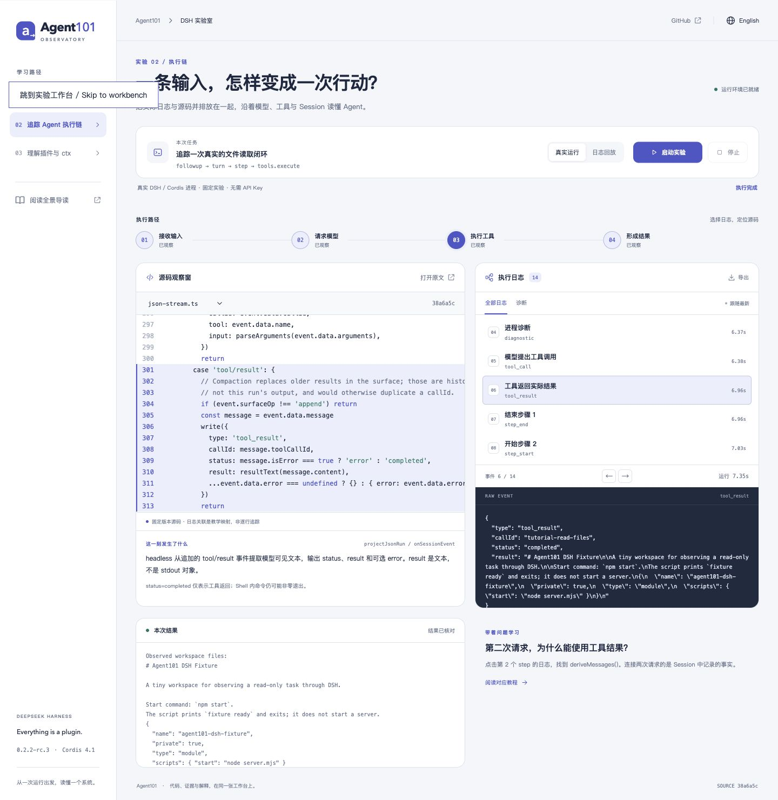

# Web 工作台验证 / Workbench verification

验证日期 / Checked: **2026-11-18**。执行平台 / Executed platform: **macOS arm64, Node v24.11.1**。

## 实际运行 / Actual execution

[可重复验证脚本](../scripts/verify-runtime.mjs)通过临时 HTTP 服务，调用真实 API 并读取 SSE，结果见 [runtime-verification.json](runtime-verification.json)。

The [reproducible verification script](../scripts/verify-runtime.mjs) starts a temporary HTTP server, calls the real API and consumes SSE. Results are in [runtime-verification.json](runtime-verification.json).

| 场景 / Scenario | 观察结果 / Observation |
| --- | --- |
| DSH live | 1 tool call + 1 linked tool result; both fixture contents in the tool result and final reply; unchanged files; 2 actual adapter diagnostics; validated=true |
| Cordis live | 12 lifecycle observations, including PASS; dependency activation, cleanup and replacement assertions pass; validated=true |
| DSH replay | Existing repository events replay in order; recordedEvidence=true; validated=false |
| DSH live cancellation | After receiving actual child output, the API requests stop; status=cancelled and code=CANCELLED |
| Existing source-checkout CLI | Refactored shared Cordis exercise still passes against pinned upstream checkout |

Cordis 发布 JS 不导出 const enum `FiberState`。Web 实验与原源码实验一样，在内存编译包自带的源码后运行；没有模拟服务生命周期。

The Cordis published JS omits the const enum `FiberState`. The Web experiment compiles the source shipped with the installed package in memory, as the original source exercise does. Lifecycle operations are not simulated.

## 检查 / Checks

- `npm test`: 10 passing tests cover API host/origin/token boundaries, allowlists, invalid input, a single active run, cancellation, cursor-based stream recovery, missing runtime, failed/timeout outcomes and source-stage associations.
- `npm run check` / `npm run build`: snapshot SHA-256, source range bounds, locale-key parity, design color mappings, JavaScript syntax and safe DOM insertion checks pass. There is no frontend bundling stage.
- [Strict UI audit](premium-audit.json): zero findings. Static HTML buttons stay disabled until their module-owned handlers are connected; the audit cannot itself verify runtime event wiring.
- [DESIGN.md lint](design-lint.json): zero errors and warnings.

## 浏览器验收 / Browser acceptance

在实际浏览器中检查了以下操作 / Checked in the real browser:

- Empty → running → validated completion for DSH and Cordis; actual tool text and lifecycle PASS visible.
- Source associations for tool_result, second step and plugin replacement; selected rows scroll inside the log pane without moving document focus.
- Stop replay → stopped; existing evidence remains available. Actual child-process cancellation is verified separately through the runtime API script; timeout paths use an injected executor in API tests.
- Refresh restores retained run events. After server restart, an expired run displays a recovery message.
- A separate server with runtime availability disabled blocks live execution, explains installation, and completes replay without runtime installation.
- Chinese/English switching preserves data; source select and Tab navigation retain visible focus; JSONL export downloads actual events.
- 1440px desktop and 390px narrow layout have no document-level horizontal overflow; long source lines scroll within their pane. Both locale layouts were inspected.
- Scrollbar styling observed on the source pane. Reduced-motion and forced-color rules are present in CSS; OS preference switching was not performed.

## 限制 / Limits

固定适配器不是远程模型；源码关联不是插桩。真实运行检查每个场景一次，浏览器另外做了人工实跑；这些结果不构成可靠性基准。其他操作系统未实测，公网/多用户部署不在本次范围内。运行状态只在服务内存保留，关闭服务后不能恢复。

A fixed adapter is not a remote model, and source links are not instrumentation. The automated runtime script executes each scenario once, with additional manual browser runs; these are not reliability benchmarks. Other operating systems were not exercised. Public/multi-user deployment is outside this version. Run state lives only in server memory.
